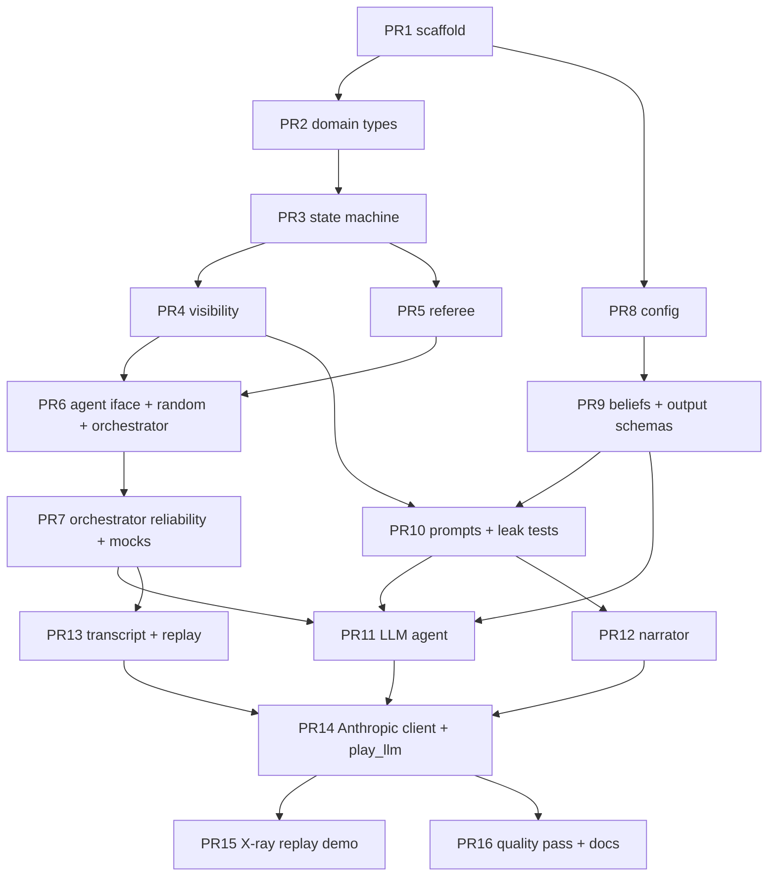

# Reimplementation PR plan

How I'd rebuild **mafia-agents** from an empty repo as a sequence of small, reviewable
PRs. Each PR is dependency-ordered, leaves `main` green (tests + mypy), and has an explicit
gate. This is a companion to `MAFIA_AGENTS_SPEC.md` and `phase2_build.md`; it re-slices the
same system into review units rather than build phases.

## Guiding principles for the split

1. **Every PR leaves the repo green.** Tests and mypy pass at each merge. No PR depends on a
   future one to compile or pass.
2. **Dependency order, not feature order.** A PR merges only after everything it imports.
   The graph below is the source of truth for ordering.
3. **Stay off the API as long as possible.** Real LLM calls appear in the *second-to-last*
   PR. Everything before is verified against deterministic mocks/stubs, so the API switch-on
   tests auth and parsing, not logic.
4. **Security boundaries get their own PR and their own test tier.** Visibility (data) and
   prompt rendering (bytes) are separate PRs, each with property tests that run forever.
5. **One reviewer concern per PR.** A PR introduces one idea (a schema, a boundary, a loop)
   so review is about *that*, not a diff spanning five layers.
6. **The engine never imports an LLM.** Enforced by an import-audit test from the first
   engine PR onward.

## Dependency graph

Critical path: **1 → 2 → 3 → 4/5 → 6 → 7 → 11 → 13 → 14 → 15**. PRs 8, 9, 10, 12 are
parallelizable side branches that rejoin at 11/13/14.

---

## The PRs

Sizes: **S** ≈ <150 lines, **M** ≈ 150–400, **L** ≈ 400+ (still one concern; split if review
drags).

> **Status: PR1–PR3 complete.** The pure engine is done end to end — scaffold, domain
> types, and the full state machine (night + day + both voting modes + win conditions →
> `GAME_OVER`). Scripted games terminate in both modes and a Town win is proven
> reachable. **PR4 (visibility boundary) is also complete** — `engine/visibility.py`
> with `observable_view` / `narrator_view` / `RosterEntry` / `ObservableState`, plus
> tier-1 leak tests over every intermediate state of many random games (both modes).
> **PR5 (referee) is also complete** — `engine/referee.py` with `validate_action`
> (reason per illegal case), deterministic seeded `fallback_action` (always legal),
> and never-raising `coerce_action`. **PR6 (agent interface + random agent +
> orchestrator) is also complete** — split into 6a (interface + random agent, no
> tests) and 6b (async orchestrator loop wiring PR4 views + PR5 coercion, with the
> full-game gate). Random games complete and are reproducible in both modes, and
> misbehaving agents (None/illegal) still can't stall the game. **PR7
> (orchestrator reliability + mock agents) is also complete** —
> `agents/mock_agent.py` (`ScriptedAgent`: legal/illegal/raise/hang) and, in
> `orchestrator.py`, retry-then-fallback for malformed (kept distinct from) timeout
> + bounded backoff for outages, a `CostLedger` + ceiling → recorded abort, and
> reliability counters on `RunResult`. All proven against mocks, zero API. **PR8
> (config) is also complete** — `config.py`: `GameConfig` (seed, mode, memory
> strategy, per-role `ModelRoster`, prompt version, cost ceiling, retry/backoff),
> `MODEL_PRICING` + `cost_usd`, `MemoryStrategy`, `validate_models`, and
> `api_key_from_env` (key never a field). 120 tests passing, mypy `--strict` clean.
>
> **PR9 (split 9a/9b) is DONE.** `agents/beliefs.py`: 9a = data shapes
> (`BeliefState` + cursor, `TargetOutput`/`TextOutput`, frozen, testless like 6a);
> 9b = adapters (`output_schema_for`, `to_engine_action` stamps `actor_id` from the
> request, `parse_belief_state`), both returning `(value, reason)` and never raising.
> +13 tests, mypy `--strict` clean.
>
> **PR10a (prompts) is DONE.** `agents/prompts.py`: `PROMPT_VERSION`,
> `RenderedPrompt{system,user}`, role system prompts, event/roster/beliefs
> renderers, three `MemoryStrategy` history modes, per-action ask + retry variant.
> One entry point `render_prompt(view, request, *, strategy, belief,
> recent_events_count, retry_reason)`. Renders from `ObservableState`/
> `ActionRequest`/`BeliefState` only — never `GameState`. Testless like 6a/9a; mypy
> `--strict` clean (31 files).
>
> **PR10b (leak tests) is DONE.** `tests/test_prompts.py`: behavioral scan of the
> rendered `user` string for every viewer × memory strategy × mid-game state (and
> every role × action via the request corpus) — no Mafia-only content to non-Mafia,
> no seer result to non-Seers, no other player's unrevealed role; public reveals do
> reach everyone. Corpus proven non-vacuous, detector proven to fire on a forged
> leak. Plus the AST test proving `prompts.py` never references `GameState`
> (Name/ImportFrom/Attribute). +6 tests → 122 passing, mypy `--strict` clean (32).
>
> **PR11a (model seam + records) is DONE.** `agents/llm_agent.py`: `ModelClient`
> Protocol (`complete_structured`/`complete_text`, async, malformed→None,
> outage→raises), `TokenUsage` (+`__add__`), `CostCallback` + `noop_cost_callback`,
> `StepRecord` (per-turn snapshot for PR13). No graph, no network, no LangGraph dep.
> Testless like 6a/9a/10a; mypy `--strict` clean (33 files).
>
> **PR11b (the LLM agent) is DONE.** `agents/llm_agent.py`: `LlmAgent`
> (`AgentInterface`) runs a belief→reason→act LangGraph subgraph per turn —
> conditional edge skips the belief node on an empty event delta; reasoning feeds
> act; persistent `BeliefState` on the instance; `StepRecord` per turn; per-call
> cost via `CostCallback`. Malformed→`None`, outage→propagates (no internal retry).
> `langgraph` added to deps. Proven against a stub `ModelClient` (no real API — PR14).
> +8 tests → 147 passing (async now active), mypy `--strict` clean (34 files).
>
> **PR12 (narrator agent) is DONE.** `agents/narrator_agent.py`: `NarratorAgent`
> — a *separate* degenerate `AgentInterface`, not a configured `LlmAgent`. One
> `complete_structured` call → `TextOutput` → `Narration` (`actor_id` stamped from
> the request); no belief node, no reasoning node. Pinned to `NARRATOR_MODEL`
> (Haiku), cost charged via `CostCallback`. Malformed→`None` (feeds referee's
> `CANNED_NARRATION`), outage→propagates (no internal retry). Driven only from
> `narrator_view`. +8 tests → 155 passing, mypy `--strict` clean (36 files). The
> gate proves it produces a `Narration` and that its rendered prompt bytes carry
> no mafia/kill/seer markers, against a non-vacuous mid-game state.
>
> **PR13 (transcript + replay) is DONE.** `transcript.py`: `Transcript` (config +
> ordered `ActionRecord`s + full final `GameState` + winner + `RunSummary`),
> `NodeOutputs` (raw-model-output shape, populated at PR14), `build_transcript`,
> `write_transcript` → `games/{ts}_{seed}_{mode}.json`, `load_transcript`, and the
> self-proving `replay_check` (re-applies recorded actions through the pure engine,
> asserts the reconstructed state == the recorded one). No API. +6 tests → 161
> passing, mypy `--strict` clean (38 files). Gate proven against mock games:
> schema-valid, `replay_check` passes both modes, write→load→re-serialize
> byte-stable, fallback-heavy game replays, aborted (cost-ceiling) game replays to
> its stopping point. *Self-correction during build:* the first `replay_check`
> loop gated on `i < len(actions)`, which stopped before the trailing automatic
> transitions (`DAY_ANNOUNCE` → win check → `GAME_OVER`) ran, so completed games
> replayed to the wrong state; fixed to gate on `GAME_OVER` and break only when an
> action is needed but the recorded list is spent.
>
> **PR14 (API switch-on) — CODE DONE, live steps pending.** Split 14a/14b.
> *14a:* `agents/anthropic_client.py` `AnthropicModelClient` (implements the PR11a
> `ModelClient` over `langchain-anthropic`; `with_structured_output(include_raw=True)`
> so a parse failure is `parsed=None`, never a raise; outages propagate; token
> usage from `usage_metadata`; concrete model injectable for offline tests), and a
> shared-`CostLedger` param on `play_game` so agent-reported spend gates the game.
> *14b:* `scripts/play_llm.py` — `build_agents` (one `LlmAgent` per dealt player,
> model by role, + `NarratorAgent`, each charging one shared ledger), `play_llm`
> (stamps live `PROMPT_VERSION` at the call site — a field default can't, since
> `prompts`→`config` would be circular — plays, builds transcript, asserts
> `replay_check`), `--dry-run` (offline zero-token stub) / `--smoke` / full-game
> CLI. `langchain-anthropic` added to deps; `transcript.py` + `scripts` added to
> mypy. +14 tests → 175 passing, mypy `--strict` clean (43 files). Offline gate
> proven: `--dry-run` completes both modes with zero spend, transcript writes +
> reloads + replays, `PROMPT_VERSION` stamped, shared ledger aborts on breach.
> *Self-corrections during build:* the dry-run stub and the client both first used
> a non-generic `complete_structured` signature that didn't satisfy the `OutputT`
> `ModelClient` protocol — made both generic with `cast`.
> **Live game DONE.** `--smoke` verified auth/parse/cost; one capped live game
> (seed 0, simultaneous, Haiku) played clean: **Mafia win, 30 actions, 0
> fallbacks, $0.20**, `replay_check` passes. Written to
> `games/20260804T134443Z_0_simultaneous.json` — the demo transcript.
>
> **Reasoning capture (follow-up, user-approved).** The transcript needed private
> reasoning for the X-ray, which PR13/14 hadn't wired (flagged, not silently
> fixed). Added: `NodeOutputs.action_type` + `NodeOutputs.from_step_record`, a
> per-actor `Transcript.reasoning` stream, `build_transcript(..., step_records=)`,
> and `collect_step_records` in `play_llm` (each `LlmAgent`'s turns; Narrator
> contributes none). `StepRecord` imported under `TYPE_CHECKING` so `transcript.py`
> stays langgraph-free at runtime. +2 offline tests → 177 passing, mypy `--strict`
> clean. Re-ran the live game to capture reasoning (29 turns, 6 players; contains a
> clean "mafia mask" moment).
>
> **SCOPE (set at PR14):** the goal is a single *demoable* game + the X-ray replay,
> NOT the Section 5 voting experiment. Ignore the spec's stats/batch/budget framing:
> no multi-game runs, no cost calibration. PR15 (the replay HTML) is the real
> deliverable; PR16 = make the one game demo-grade.
>
> **PR15 (X-ray replay) is DONE.** `scripts/build_replay.py`: transcript → one
> self-contained HTML page (all CSS/JS inline, committed dark "stage" theme with
> night/day ambient). `build_view_model` correlates each agent event to its private
> turn via per-`(actor, action_type)` FIFO queues over the reasoning stream;
> `escape_for_script` neutralises `<`/`>`/`&` (+ U+2028/9) so a chat line can't
> break the JSON `<script>` tag; `render_html` embeds it; roster shows every true
> role (omniscient X-ray); step/play/scrub UI + keyboard; Mafia public-turn "mask"
> moments flagged. +4 offline tests (dry-run transcript) → 181 passing, mypy
> `--strict` clean (45 files). Ran on the real demo game →
> `games/20260804T134443Z_0_simultaneous.html` (76 KB): 34 steps, 29 with
> reasoning, 6 mask moments, embedded JSON round-trips, no tag breakout.
> *Self-correction during build:* two CSS hex typos and a stray unused
> `type: ignore` fixed; the U+2028/9 escapes were correct (Read renders them as
> spaces).
> **PR16 (quality pass + docs) is DONE.** Read both demo transcripts end to end for
> coherence, role fidelity, public/private daylight, belief sanity — both demo-grade.
> Found and fixed one real prompt bug: the "fellow Mafia" line rendered
> `known_mafia_ids` verbatim, so a Mafia was listed among its own allies (a model
> flagged the contradiction and burned a turn on it). Fix excludes `view.self_id`
> in `render_prompt`; bumped `PROMPT_VERSION` v0 → v1 (and the hand-copied
> `config.py` default, to close the PR14 drift note); +1 regression test
> (`test_mafia_ally_line_excludes_self`), leak tests stay green → 182 passing,
> mypy `--strict` clean. Re-ran both demo games live on v1 (0 fallbacks,
> replay_check passes, ~$0.20 + ~$0.31) and rebuilt their X-ray replays; the v0
> demo pair is superseded. Wrote `README.md` (run + demo + boundaries) and
> `bugs.md` (the fix + two known quirks). Demo-transcript memory repointed to the
> v1 games. **All 16 PRs complete.**

### PR1 — Repo scaffold & tooling · S ✅ DONE
- **Depends on:** —
- **Goal.** A repo that lints, type-checks, and tests green with nothing in it yet.
- **Scope.** `pyproject.toml` (pydantic, pytest, pytest-asyncio, mypy), `mypy`/`pytest`
  config, package layout (`engine/`, `agents/`, `tests/`), `.gitignore` (incl. `games/`),
  `CLAUDE.md` conventions, a trivial CI workflow.
- **Gate.** `pytest` (one placeholder test) and `mypy` both pass in CI.

### PR2 — Domain types · M ✅ DONE
- **Depends on:** PR1
- **Goal.** The immutable data model and the deterministic deal — no behavior yet.
- **Scope.** `engine/state.py` (`GameState`, `PlayerState`, `Role`, `Faction`, `Phase`,
  `Event`, `EventType`, `Visibility`/`VisibilityKind`, `VotingMode`), `engine/actions.py`
  (`Action` union, `ActionType`, `ActionRequest`), `new_game(seed, mode)`.
- **Gate.** Construction + JSON round-trip tests; `new_game` is deterministic from
  `(seed, mode)`; **import-audit test** asserts `engine/` imports no network/LLM libs.

### PR3 — The state machine · L (split into sub-PRs) ✅ DONE
- **Depends on:** PR2
- **Goal.** The pure loop contract: `next_requests` / `resolve_automatic` / `apply`.
- **Scope.** `engine/engine.py`. Night phases (mafia chat ordering, seer, kill), day phases
  (announce, narrate, discuss ×2 rounds, vote), both voting modes with ballot staging, win
  conditions → `GAME_OVER`. Event emission with visibility tags.
- **Gate.** Phase-transition tests; tie vs plurality in both modes; ballot-visibility timing
  (reveal-after vs reveal-on-cast); win conditions incl. game-ending night kill; dead-Seer
  no-op phase. A directed test proves a Town win is reachable.

**Actual split taken** — PR3 was too large for one review unit, so it was cut into
sub-PRs, each leaving the repo green (tests + mypy):

- **PR3a-i — Loop contract + dispatch skeleton.** ✅ `next_requests` / `resolve_automatic` /
  `apply` as thin pure dispatchers on `state.phase`; per-phase handler protocol + registry;
  `PHASE_CYCLE` / `next_phase` / `advance_phase` machinery. Every phase maps to a stub that
  raises `NotImplementedError` (loud, not silent). *Gate:* dispatch routing; cycle + wrap;
  advance resets counters / bumps day. *(Tests landed with 3a-ii.)*
- **PR3a-ii — Night handlers.** ✅ `NIGHT_MAFIA_CHAT` (2 rounds, killer-first, solo-Mafia
  skip), `NIGHT_SEER` (investigation + dead-Seer silent no-op), `NIGHT_KILL` (designated-killer
  rotation, flips victim, `MAFIA_ONLY` `NIGHT_KILL` event), parking at `DAY_ANNOUNCE`. Added
  `EventType.NIGHT_KILL` so `DAY_ANNOUNCE` can reveal the victim later. *Gate:* killer
  rotation, chat order/skip, seer pre-kill + dead-Seer no-op, kill flip + visibility tags,
  monotonic event ids, full-night integration.
- **PR3b-i — Talking day.** ✅ `DAY_ANNOUNCE` (auto public death reveal from the night kill),
  `DAY_NARRATE` (Narrator flavor via `NARRATOR_ID`), `DAY_DISCUSS` (2 rounds in rotated
  speaking order). Added `_speaking_order` + `revealed_role` on emitted events.
- **PR3b-ii — Voting.** ✅ `DAY_VOTE` both modes via one handler: simultaneous (ballots
  staged silently in `GameState.ballots`, revealed PUBLIC in seat order) and sequential
  (revealed on cast); plurality eliminates, ties = no elimination, role revealed. *Gate:*
  reveal timing, application-order independence, tie handling, both modes wrap to next night.
- **PR3c — Win conditions + game-over.** ✅ `winner(state)` predicate; win checks after every
  death (announce + vote); game-ending night kill announces then short-circuits to
  `GAME_OVER`; terminal `_GameOverHandler`. *Gate:* both win conditions, game-ending night
  kill, voting out last Mafia, full scripted games terminate in both modes, directed
  Town-win reachable.

### PR4 — Visibility boundary · M ✅ DONE
- **Depends on:** PR3
- **Goal.** The single choke point where agent-visible state is produced.
- **Scope.** `engine/visibility.py`: `observable_view(state, id) -> ObservableState`,
  `RosterEntry`, `known_mafia_ids`, filtered events (event_ids preserved), narrator view.
- **Gate (tier-1 leak tests).** Property tests over every intermediate state of many random
  games, both modes: no living/unrevealed role leaks, mafia chat invisible to non-mafia,
  seer results private, mafia know allies, narrator sees public-only.

### PR5 — Referee · S/M ✅ DONE
- **Depends on:** PR3
- **Goal.** Liveness: an agent can never deadlock the game.
- **Scope.** `engine/referee.py`: `validate_action` (human-readable reason),
  `fallback_action` (deterministic, seeded), `coerce_action` (never fails).
- **Gate.** Validation reasons per illegal case; fallback determinism (same state+request →
  same fallback); coerce never raises.

### PR6 — Agent interface, random agent, orchestrator · M ✅ DONE
- **Depends on:** PR4, PR5
- **Split taken:** **PR6a** (`agents/interface.py` `AgentInterface` Protocol,
  async, `act -> Action | None`; `agents/random_agent.py`) landed with no tests of
  its own — it is exercised by 6b. **PR6b** (`orchestrator.py`: async loop,
  `asyncio.gather` fan-out for simultaneous votes, per-agent `event_id` cursors,
  `RunResult`) landed with the full-game gate.
- **Goal.** Wire agents to the engine; play a full game end-to-end (still no LLM).
- **Scope.** `agents/interface.py` (`AgentInterface` Protocol, async, `act -> Optional[Action]`
  from day one — see *Hindsight* #1), `agents/random_agent.py`, `orchestrator.py` (async
  loop, `asyncio.gather` fan-out for simultaneous votes, per-agent event cursors).
- **Gate.** Random games complete in both modes; transcripts reproducible from seeds.

### PR7 — Orchestrator reliability + mock agents · M ✅ DONE
- **Depends on:** PR6
- **Goal.** All the failure machinery, proven before any real API exists.
- **Scope.** `agents/mock_agent.py` (`ScriptedAgent`: legal/illegal/raise/hang); in
  `orchestrator.py` — retry-then-fallback (malformed), timeout + bounded backoff
  (api_failure, kept distinct), `CostLedger` + ceiling → recorded abort, cursor wiring,
  **application-order** action capture.
- **Gate.** Mock games: hang → timeout → fallback and still completes; illegal-then-legal →
  `retried_ok`; cost breach aborts and is recorded; cursors match what each agent saw.

### PR8 — Config · S ✅ DONE
- **Depends on:** PR1 (parallel to the engine track)
- **Goal.** The single object serialized into every transcript.
- **Scope.** `config.py`: `GameConfig` (models per role group, memory strategy, seed, voting
  mode, `PROMPT_VERSION` field, cost ceiling, retry/backoff), `MODEL_PRICING`, `cost_usd`,
  `MemoryStrategy`, API key from env. `validate_models`.
- **Gate.** Round-trips JSON; `validate_models` rejects an unpriced model; no secrets in the
  serialized form.

### PR9 — Belief state + LLM output schemas · M ✅ DONE (split 9a/9b)
- **Depends on:** PR8 (and PR2 for `Action`)
- **Goal.** The LLM-facing schemas and the adapter onto engine actions.
- **Scope.** `agents/beliefs.py`: `BeliefState` (+ cursor), `TargetOutput`/`TextOutput`,
  `output_schema_for`, `to_engine_action` (stamps `actor_id` from the request),
  `parse_belief_state`. Both adapters return `(value, reason)` and never raise.
- **Gate.** Schema round-trips; adapter output passes `validate_action` for every request
  type; malformed dict → reason, not exception.

### PR10 — Prompts + rendered-prompt leak tests · M ✅ DONE (split 10a/10b)
- **Depends on:** PR4, PR9
- **Goal.** The bytes the model actually sees, and the tier-2 security boundary.
- **Scope.** `agents/prompts.py`: `PROMPT_VERSION`, role system prompts, per-action blocks
  (legal targets + retry variant), three memory strategies. Renders from
  `ObservableState`/`ActionRequest`/`BeliefState` only — never `GameState`.
- **Gate (tier-2 leak tests).** Render the final prompt string for every
  (role × action × strategy) against real mid-game states; assert no other player's
  unrevealed role, seer result, or mafia-only content appears. AST import-discipline test:
  prompts.py never references `GameState`.

### PR11 — The LLM agent · M ✅ DONE (split 11a/11b)
- **Depends on:** PR7, PR9, PR10
- **Goal.** A language model as a drop-in player.
- **Scope.** `agents/llm_agent.py`: `ModelClient` seam (structured/text, malformed→None,
  outages raise), LangGraph 3-node subgraph (belief → reason → act with empty-delta skip),
  persistent `BeliefState` on the instance, `StepRecord` for the transcript, cost callback.
  Decide up front whether reasoning feeds the action node (this project chose **yes**).
- **Gate (stubbed model, no API).** Node order belief→reason→act; empty delta skips node 1;
  beliefs persist across turns; malformed action → `None` (feeds retry); model exception
  propagates (api_failure), no internal retry.

### PR12 — The narrator agent · S ✅ DONE
- **Depends on:** PR10
- **Goal.** The death-flavor agent — deliberately minimal, a *separate class*.
- **Scope.** `agents/narrator_agent.py`: single model call, no beliefs, no reasoning node,
  renders via the shared `render_action` from the public-only narrator view; cost under a
  separate `NARRATOR_ID` ledger key.
- **Gate (stubbed).** Produces a `Narration`; its prompt bytes carry no mafia/seer markers.

### PR13 — Transcript writer + replay · M ✅ DONE
- **Depends on:** PR7
- **Goal.** One self-proving JSON record per game.
- **Scope.** `transcript.py`: `Transcript`/`ActionRecord` (discriminated `Action` union) /
  `NodeOutputs` / cost / fallbacks / aborted; `build_transcript(config, run)`;
  `write_transcript` → `games/{ts}_{seed}_{mode}.json`; `load_transcript`; `replay_check`
  (re-apply recorded actions, assert final state matches). Orchestrator records applied
  actions in application order (folded here if not already in PR7).
- **Gate (mock game).** Schema-valid transcript; `replay_check` passes both modes; load +
  re-serialize byte-stable; **fallback** actions replay; **aborted** game replays to its
  stopping point.

### PR14 — Anthropic client + `play_llm` + first real games · M ✅ DONE
- **Depends on:** PR11, PR12, PR13
- **Goal.** The API switch-on, wired end to end.
- **Scope.** `AnthropicModelClient` (langchain-anthropic, `include_raw=True` so parse
  failures don't raise), shared-`CostLedger` param on the orchestrator, `scripts/play_llm.py`
  (`--dry-run` stub / `--smoke` / full game; writes transcript + runs `replay_check`; stamps
  `PROMPT_VERSION` — see *Hindsight* #2).
  - **Drift note (flag from PR13 review).** `GameConfig.prompt_version` currently defaults to
    the *literal* `"v0"`, a hand-copied duplicate of `prompts.PROMPT_VERSION`. The two can
    silently drift: bump the prompt module and any config that doesn't re-stamp still reads
    `"v0"`. PR14 closes this by stamping the live `prompts.PROMPT_VERSION` at `GameConfig`
    construction in `play_llm.py`. Consider also making the field default pull from
    `prompts.PROMPT_VERSION` (a small import) so a config built any other way can't drift
    either — decide at build time.
- **Gate.** `--dry-run` completes both modes offline (zero spend); then a live `--smoke`,
  then a full all-Haiku game per mode under a cost ceiling, with sane fallback counts.
  *(The live steps are manual and gated on spend — everything else is CI-automatable.)*

### PR15 — X-ray replay demo · M ✅ DONE
- **Depends on:** PR14
- **Goal.** The thing you actually show: public record beside private reasoning.
- **Scope.** `scripts/build_replay.py`: transcript → self-contained HTML; correlates each
  event to the turn that produced it via per-`(actor, action_type)` reasoning queues;
  step/play/scrub UI, night/day ambient, theme-aware.
- **Gate.** Renders a real transcript; embedded JSON is valid and can't break out of the
  script tag (escape `<`); Mafia mask moments are marked.

### PR16 — Quality pass + docs · S (open-ended)
- **Depends on:** PR14
- **Goal.** The spec's exit gate: read transcripts, tune prompts, ship docs.
- **Scope.** Read 2–3 full transcripts for coherence, role fidelity, public/private daylight,
  belief sanity. Iterate prompts (bump `PROMPT_VERSION`, keep leak tests green). Update
  `README.md`. Optionally a `bugs.md` log.
- **Gate.** Both modes produce demo-grade games; leak tests green; README documents run +
  demo.

---

## Suggested review batches

If you want fewer, larger review rounds instead of 16 PRs:

- **Batch A — Engine (PRs 2–6):** the pure, deterministic core + a playable random game.
- **Batch B — Reliability & LLM plumbing (PRs 7–13):** everything with zero real API calls.
- **Batch C — API & demo (PRs 14–16):** the switch-on and the shippable demo.

Each batch is independently green and demoable (A: a printed random game; B: a full stubbed
game with a valid transcript; C: a real game + the X-ray replay).

