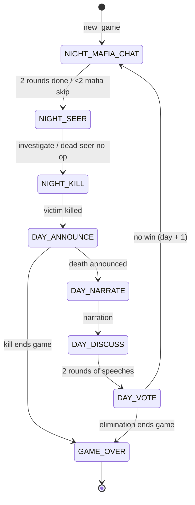
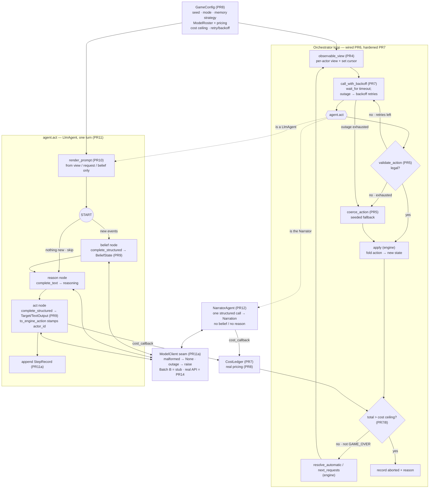
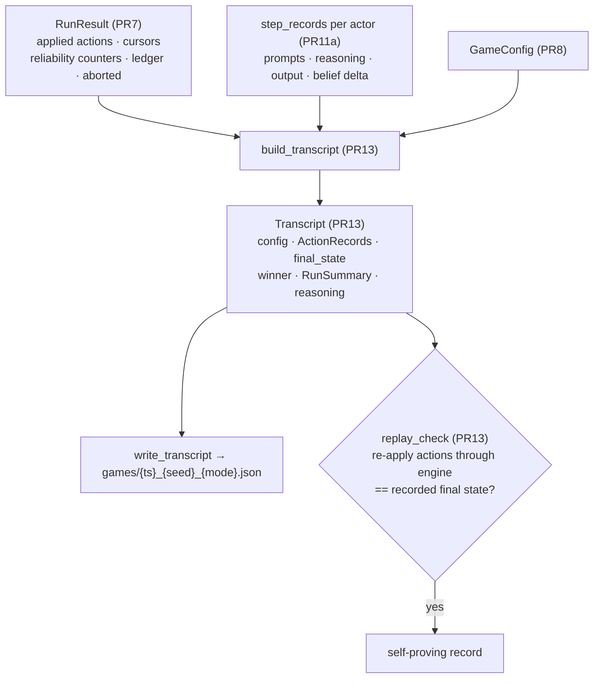

# Design decisions

A running log of engine/architecture decisions worth remembering. Newest entries
can be appended as the build progresses.

---

## The phase state machine (PR3)

The engine is a pure state machine over eight phases. Three pure functions drive
it — `next_requests` (who must act), `resolve_automatic` (advance phases needing
no agent), `apply` (fold one validated action into a new state) — each a thin
dispatcher onto a per-phase handler. No mutation, no LLM: every function returns
a new `GameState`.



ASCII fallback (for terminals that don't render Mermaid):

```

State machine after PR3:
                        new_game()
                            │
                            ▼
        ┌──────────────────────────────────────────────┐
        │                  NIGHT                        │
        │                                               │
        │   NIGHT_MAFIA_CHAT ──(<2 mafia: skip)──┐      │
        │        │ 2 rounds                      │      │
        │        ▼                               ▼      │
        │   NIGHT_SEER ──────(no living seer)──► (no-op)│
        │        │ investigate                   │      │
        │        ▼                               │      │
        │   NIGHT_KILL ◄─────────────────────────┘      │
        │        │ designated killer                    │
        └────────┼──────────────────────────────────────┘
                 ▼
            DAY_ANNOUNCE  ──(kill ends game)──►  GAME_OVER ◄─┐
                 │ auto: reveal death                        │
                 ▼                                           │
            DAY_NARRATE                                      │
                 │ narrator                                  │
                 ▼                                           │
            DAY_DISCUSS                                      │
                 │ 2 rounds of speeches                      │
                 ▼                                           │
            DAY_VOTE  ──(elimination ends game)──────────────┘
                 │ simultaneous | sequential
                 │ (no win)
                 └────────► back to NIGHT_MAFIA_CHAT (day + 1)
```

### What the diagram encodes

- **`PHASE_CYCLE` is the solid path.** `next_phase` walks the linear night→day
  order and wraps `DAY_VOTE → NIGHT_MAFIA_CHAT`, incrementing the day number.
  `GAME_OVER` is terminal and not in the cycle.
- **Who drives each transition.** Agent-action phases (chat, seer, kill, narrate,
  discuss, vote) advance inside `apply` when the phase completes. Auto phases
  (`DAY_ANNOUNCE`, and the two night skips) advance inside `resolve_automatic`
  with no agent involved.
- **Win checks live on exactly the two death edges:** after `DAY_ANNOUNCE` (the
  night kill) and after `DAY_VOTE` resolution (the elimination). A game-ending
  night kill still *announces* the death, then jumps straight to `GAME_OVER` —
  no narration, discussion, or vote.
- **Night sub-phases always run in order, even when they no-op.** A solo-mafia
  chat is skipped and a dead-seer investigation resolves to nothing, but the
  phases still *occur* — so the game's structure never reveals whether the Seer
  is alive.
- **`GAME_OVER` is the only sink.** Everything else loops night→day→night until a
  win edge fires.

### Why a state machine (and not a linear script)

- The loop contract stays tiny and pure, so the whole game is deterministic and
  testable with zero LLM calls.
- Phase logic is isolated per handler (a dispatch table keyed by `Phase`), so
  adding or changing a phase touches one class, not a sprawling `if/elif`.
- The orchestrator sits *outside* the engine: it reads `next_requests`, calls
  agents, and feeds actions back through `apply` — the one seam where LLMs enter.

---

## The visibility boundary (PR4)

- **One choke point, a reference monitor.** `observable_view(state, id)` is the
  single function that turns the omniscient `GameState` into what a viewer may
  know. Agents and the Narrator NEVER touch `GameState`; every disclosure path
  routes here, so there is exactly one small file to audit and one place the leak
  tests point at.
- **It filters, it never re-derives.** Events already carry honest `Visibility`
  tags (PUBLIC / MAFIA_ONLY / PLAYER_ONLY) from birth in the state machine. The
  boundary just selects by tag and viewer identity and preserves `event_id`s (the
  orchestrator's per-agent cursor rides on them) — it trusts the tags, it doesn't
  recompute who-saw-what.
- **`ObservableState` is the per-viewer envelope; `RosterEntry` is a line item
  inside it.** Each view holds a full roster (one `RosterEntry` per player,
  including the viewer). The roster is the same public table for everyone; what
  distinguishes two views is the private fields around it — `self_role`, the
  filtered `events`, and `known_mafia_ids`.
- **Role knowledge is split by trust level.** `RosterEntry.role` is populated
  ONLY where a PUBLIC event revealed it (death or vote-out) — uniform for every
  player, no self/ally exceptions — so the invariant is clean: any non-`None`
  roster role traces to a public reveal. Private self-knowledge lives in
  `self_role`; Mafia ally identities in `known_mafia_ids`; a Seer's result stays
  on its PLAYER_ONLY event.
- **In-flight votes are unrepresentable, not just hidden.** `ObservableState` has
  no `ballots` field at all, so staged simultaneous votes cannot leak. Ballots
  reach a viewer only as PUBLIC `VOTE` events emitted after the vote closes;
  sequential mode emits each on cast by design. Visibility handles both modes
  with no special-casing.

---

## The referee (PR5)

- **`apply` trusts; the referee establishes that trust.** `apply` folds an
  already-legal action into new state, so a separate pure layer decides legality.
  `validate_action(state, request, action)` returns a human-readable *reason* when
  illegal (fed into the retry prompt) or `None` when legal — it validates the
  action against the request and trusts the request's `legal_targets`.
- **Liveness is guaranteed by `coerce_action`.** It never raises: a `None`
  (malformed / no response) or any illegal action is replaced by a fallback, so
  the caller always has a legal action and the game can never deadlock.
- **Fallbacks are deterministic and seeded on values, not object identity.**
  `fallback_action` seeds `random.Random` with a *string* key (game seed + phase +
  day + actor + history length) — stable across processes (SHA-512 derived, not
  the salted builtin `hash`), so replays reproduce. Target actions get a random
  legal target; free-text actions get a canned line.
- **Pure, no orchestration.** The referee is only legality + fallback — no agents,
  no async, no retry/backoff/timeout policy (those live in the orchestrator,
  PR6/PR7). This keeps it testable with zero I/O and honors "engine imports no
  LLM." Whose turn it is stays the engine's `next_requests` concern.

---

## Agent interface + orchestrator (PR6, split 6a/6b)

- **One narrow contract, async from day one.** `AgentInterface.act(view, request)
  -> Action | None` is the whole agent seam. `async` so real LLM calls never block
  the live-game event loop; `Action | None` so a malformed/missing response is a
  first-class value (`None`), handled identically to an illegal action by
  `coerce_action` — no interface break when the LLM agent (PR11) arrives.
- **The orchestrator is the one impure seam, and it lives outside `engine/`.** Its
  loop is `resolve_automatic → next_requests → observable_view → agent.act →
  coerce_action → apply`. This is where PR4 (each agent gets only its view) and
  PR5 (every result is coerced legal) stop being dormant and do their jobs; the
  engine still imports no LLM.
- **Simultaneous votes fan out with `asyncio.gather` against one frozen state.**
  All living voters are solicited from the same pre-vote `solicit_state`, then
  applied one at a time. Blind voting is safe precisely because the view can't
  expose in-flight ballots — proven in tests by recording the views voters were
  handed (simultaneous = no current-day ballots; sequential = later voters see
  earlier ones).
- **Per-agent cursors ride on `event_id`.** Each actor's cursor is set to the last
  event_id in *its* filtered view at solicit time — the newest event that player
  may see, not the newest in `history`. This is the foundation PR9's `beliefs_only`
  memory strategy builds on. Cursors and applied-action order are captured in
  `RunResult`, the seed the transcript (PR13) grows from.
- **Reliability is deliberately deferred to PR7.** No retries, timeouts, backoff,
  cost ceiling, or mock agents here — 6b assumes agents behave (the random agent
  does), and only proves the happy path plus liveness under None/illegal returns.

---

## Orchestrator reliability + mock agents (PR7)

- **The two failure classes stay distinct, by cause.** A *malformed/illegal*
  answer (the agent responded, but wrongly) gets one re-solicit then a coerced
  fallback — cheap and often self-correcting. An *outage/timeout* (the agent
  raised or never returned, each call bounded by `asyncio.wait_for`) gets bounded
  exponential backoff retries then a fallback. Collapsing them would waste money
  re-prompting on outages or give up too soon on fixable answers.
- **Liveness is absolute: no agent can stall or corrupt a game.** Every path ends
  in a legal action via `referee.coerce_action` — a hang times out to a fallback,
  a crash backs off then falls back, a lie is retried then falls back — so the
  loop always advances. `RunResult` counts `retried_ok` / `fallbacks` /
  `api_retries` so the transcript can show what the machinery did.
- **All of this is proven against `ScriptedAgent`, with zero real API.** The mock
  fails on command (legal / illegal / raise / hang), making every failure path
  deterministic and instant. Per the plan's rule, real API calls wait until PR14,
  so switch-on tests auth + parsing, not this logic.
- **Cost is a first-class stop condition.** A `CostLedger` accrues per-actor spend
  (Narrator billed separately); crossing `cost_ceiling` aborts the game cleanly
  and records `aborted` + `abort_reason` rather than crashing. PR7 charges a flat
  `cost_per_call`; PR8 swaps in real `MODEL_PRICING` behind the same ledger. Knobs
  live in a stopgap `ReliabilityConfig` until PR8's `GameConfig` supersedes it.

---

## Config (PR8)

- **One serializable contract for reproducibility + cost.** `GameConfig` gathers
  everything that determines a game — seed, voting mode, memory strategy, per-role
  `ModelRoster`, `prompt_version`, cost ceiling, retry/backoff — into a single
  frozen object stamped into every transcript, so a stored game ties back to the
  exact settings (and prompts) that produced it and a replay reloads them.
- **No secrets in the serialized form.** The API key is read from the environment
  (`api_key_from_env`) and is deliberately not a `GameConfig` field, so dumping a
  config to JSON can never leak it into a shared transcript. A test asserts the
  key value never appears in the dump and `api_key` isn't even a field.
- **Real pricing behind the PR7 ledger.** `MODEL_PRICING` (USD per MTok, first-
  party Anthropic rates) + `cost_usd(model, in, out)` replace PR7's flat
  `cost_per_call`; `validate_models` rejects a config naming any unpriced model,
  because it couldn't be cost-accounted or budget-aborted. Narrator defaults to
  the cheapest model (Haiku), matching the spec.
- **config.py is a pure leaf.** It imports only `engine` domain enums — no LLM, no
  network, no orchestrator. It carries the reliability knobs as plain fields;
  PR14 maps them onto the orchestrator's `ReliabilityConfig` at the call site, so
  config never depends upward.

---

## Belief state + output schemas (PR9, split 9a/9b)

- **Two output shapes for six actions, because the model's real choice is binary.**
  `TargetOutput{target_id}` (VOTE / NIGHT_KILL / INVESTIGATE) and
  `TextOutput{message}` (SPEECH / MAFIA_CHAT / NARRATE) are all the model ever
  emits — "pick a player" or "write a line." The engine's finer distinctions are
  already fixed by the phase, so the model never restates them. `output_schema_for`
  and `to_engine_action` both read `request.action_type` to pick the concrete
  `Action` class; the output carries payload only. (9a = these shapes + `BeliefState`,
  frozen and testless like 6a; 9b = the adapters below.)
- **Identity is stamped, never trusted.** `to_engine_action` sets `actor_id` from the
  *request*, not the model output — that is why neither output shape has an
  `actor_id` field. A model that tries to name another actor is ignored (proven by
  test). This closes a spoofing seam and removes a redundant failure mode.
- **The adapters are the untrusted-input guard, and they never raise.**
  `to_engine_action` and `parse_belief_state` take a raw dict and return
  `(value, reason)`: a malformed blob becomes a `reason` string (fed to the PR7
  retry prompt), never an exception that could crash the loop. The property sweep
  proves a well-formed output maps to an action that passes `validate_action` for
  every request type in real games.
- **Well-formed is not legal — that line stays with the referee.** The adapter
  guarantees only a *well-formed* `Action`; a `target_id` naming a dead/absent
  player still builds cleanly and is left for `validate_action` to reject into the
  retry→fallback path. Keeps one authority for legality (the referee), not two.
- **`BeliefState` is the private, immutable, cross-turn scratchpad.** Not part of
  `GameState`, never seen by others; it rides on the agent instance (PR11) and
  carries a `cursor` (last-seen `event_id`) so an agent knows what is new — the hook
  PR6's per-agent cursors and PR8's `beliefs_only` memory strategy build on. Frozen
  like everything else: updates produce a new instance via `model_copy`.
- **Why frozen: old vs new must be two distinct values.** Because an update makes a
  *new* `BeliefState` (via `model_copy`) instead of mutating in place, the old and
  new beliefs coexist as separate objects. Two things depend on that: PR11's belief
  node compares old vs new to detect an empty delta and skip the reason/act step
  when nothing changed (impossible if the update mutated the only copy); and PR13's
  transcript stores each step's belief as a fixed snapshot that a later update can't
  retroactively corrupt (an aliasing bug immutability rules out). Caveat: `frozen`
  guards field *reassignment*, not mutation of a contained dict — updates must go
  through `model_copy(update={...})` with fresh sub-dicts, not
  `belief.suspicions[...] = ...`.

---

## Prompts + the tier-2 boundary (PR10, split 10a/10b)

- **`prompts.py` is the *bytes* boundary; PR4 was the *data* boundary.** PR4 proved
  the view *object* holds no secrets. But a clean object can still leak if the code
  that flattens it into a prompt string reaches around it to `GameState`. PR10 is the
  render layer plus the proof that no leak survives into the actual characters sent
  to the model. Both tiers are needed: a leak can hide between a correct data object
  and a careless template.
- **One entry point, three inputs, one forbidden import.** `render_prompt(view,
  request, *, strategy, belief, recent_events_count, retry_reason) -> RenderedPrompt`
  (a frozen `{system, user}` pair) renders from `ObservableState` / `ActionRequest` /
  `BeliefState` only — never `GameState`. It picks the system prompt by role, renders
  the roster/history/action-ask, selects history depth by `MemoryStrategy`, and
  turns the referee's reason into the retry variant. `PROMPT_VERSION` stamps
  `GameConfig` so a transcript ties back to the exact wording.
- **The confidentiality tests scan the rendered string, not the object.** For every
  viewer × memory strategy × real mid-game state (and, via the request corpus, every
  role × action type) the test asserts the `user` text carries no Mafia-only content
  for non-Mafia, no `[Your investigation]` line for non-Seers, and no other player's
  *unrevealed* role in the roster — while a *publicly* revealed role still reaches
  everyone. The scan is proven non-vacuous (the corpus contains real mafia chat, seer
  results, and reveals) and the detector is proven to fire on a forged leak.
- **The AST test is the real enforcement.** "Renders only from the view" is a
  discipline the type system does not enforce; the string scan only samples. So a
  structural test parses `prompts.py` and asserts it never references `GameState` —
  as a `Name`, an `ImportFrom`, or an `Attribute`. A future edit that reaches around
  the boundary fails CI immediately, making the leak impossible by construction, not
  merely absent from today's samples. (Same pattern as the engine's no-LLM import
  audit, aimed here at `GameState`.)

---

## The LLM agent (PR11, split 11a/11b)

- **A real model, but still a plain `AgentInterface`.** `LlmAgent.act(view, request)
  -> Action | None` is the same seam `RandomAgent` implements, so the orchestrator,
  referee, and reliability machinery (PR6/PR7) drive it unchanged — swapping the
  agent is the entire integration. 11a is the plumbing (the `ModelClient` seam,
  `TokenUsage`, `StepRecord`) with no graph and no LangGraph dependency; 11b is the
  agent itself.
- **One turn is a three-node subgraph: belief → reason → act.** The belief node
  folds new events into a persistent `BeliefState`; the reason node deliberates; the
  act node emits the `Action`. Splitting cognition into ordered steps keeps each
  prompt focused, gives the agent cross-turn memory, and makes *why* it acted
  inspectable (each node's output is captured in `StepRecord` for PR13). Locked
  choice: **reasoning feeds the act node** — the deliberation is an input to the
  move, not discarded.
- **The empty-delta skip is a routing decision, not a no-op.** A conditional edge
  from `START` bypasses the belief node entirely when no event is newer than the
  belief's cursor — so an agent that has seen nothing new spends nothing re-deriving
  beliefs. This is exactly why `BeliefState` is frozen: the cursor comparison needs a
  stable "last seen," and the update produces a new value rather than mutating one.
- **Two failure classes, mirrored from the orchestrator, decided at the seam.** The
  `ModelClient` returns `None` for a malformed/empty reply (→ `act` returns `None`,
  and PR7 retries then the referee coerces a fallback) but *raises* on an outage
  (→ propagates to the orchestrator's backoff). The agent never retries the network
  itself — it reports honestly and lets the machinery decide. Proven against a stub
  `ModelClient`, with **no real API** (that is PR14): node order, the skip, belief
  persistence across turns, malformed→`None`, exception propagation, and per-call
  cost accounting.
- **A wiring gap noted for later.** `AgentInterface.act` carries no referee *reason*,
  so PR10's retry-prompt variant is not yet fed on a retry (the agent re-renders the
  base prompt). Closing it needs the reason to reach the agent — an interface change
  deferred past PR11.

---

## Batch B end to end: reliability + LLM plumbing (PR7–PR13)

Batch B is everything between the pure engine and the real API — the machinery that
lets a language model play a hardened game and leaves a self-proving record, all with
**zero real API calls** (the switch-on is PR14). One mental model holds it together:

- The **orchestrator loop** is the spine (PR6), and PR7 wraps every agent call in a
  two-failure-class reliability policy. It is the only impure seam.
- One `agent.act` is filled by the **LlmAgent** — render (PR10) → belief→reason→act
  (PR11) over the output schemas (PR9), behind the `ModelClient` seam (PR11a).
- **Config** (PR8) feeds strategy, models, pricing, and ceilings into both.
- The **referee** (PR5) guarantees every turn ends in a legal action — liveness.
- The run becomes a **transcript** (PR13) that `replay_check` re-proves against the
  engine.

### One orchestrated turn



### From run to transcript



ASCII fallback (the core seam, for terminals that don't render Mermaid):

```
Per turn (the one impure seam):

  engine.next_requests
        │  ActionRequest(s)
        ▼
  observable_view (PR4) ──► render_prompt (PR10) ──► belief→reason→act (PR11)
        │  per-actor view          │  bytes                  │  via ModelClient (PR11a)
        │                          │                         ▼
        │                          │                    Action | None
        ▼                          │                         │
  reliability (PR7): timeout+backoff on outage,              │
  retry on malformed, else coerce_action (PR5) ◄─────────────┘
        │  guaranteed-legal Action
        ▼
  engine.apply  ──►  new GameState   (cost → CostLedger; ceiling aborts)
        └────── loop until GAME_OVER ──────►  RunResult ──► build_transcript (PR13)
                                                                  │
                                                        replay_check re-proves it
```

### What the diagram encodes

- **The loop is the only impure seam (PR6/PR7).** `resolve_automatic → next_requests
  → observable_view → agent.act → coerce → apply` repeats to `GAME_OVER`. The engine
  stays pure; every LLM touch is inside `agent.act`.
- **Two failure classes, never merged (PR7).** An *outage/timeout* (the agent raised
  or hung) takes the `call_with_backoff` retry-with-backoff path; a *malformed/illegal*
  answer (the agent replied, but wrongly) is re-solicited up to `malformed_retries`.
  Both dead-end in `coerce_action` (PR5), so the loop always advances — absolute
  liveness.
- **`observable_view` (PR4) is the sole input to any agent; config (PR8) sets the
  knobs.** The agent never sees `GameState`; the memory strategy, model roster,
  pricing, ceiling, and retry policy all come from the one frozen `GameConfig`.
- **One `act` is a three-node subgraph (PR11) over two output shapes (PR9).** Belief
  folds new events (skipped on an empty delta); reason deliberates; act emits a
  `TargetOutput`/`TextOutput` that `to_engine_action` stamps with the request's
  `actor_id`. Each node reaches the model only through the `ModelClient` seam (PR11a),
  which is a stub in Batch B — the real Anthropic client is PR14.
- **The Narrator is a separate degenerate agent (PR12).** Same seam, but one
  structured call → `Narration`; no belief, no reason. A distinct class so it can
  never be handed a player's private view.
- **Cost is a first-class stop condition (PR7 mechanism, PR8 pricing).** Every model
  call charges the shared `CostLedger`; when the total crosses the ceiling the game
  aborts cleanly and records the reason rather than crashing.
- **The run is provable, not just recorded (PR13).** `RunResult` (applied actions,
  cursors, counters) plus per-actor `step_records` feed `build_transcript`; the
  resulting `Transcript` carries the config, the full final state, and the private
  reasoning. `replay_check` re-applies every recorded action through the pure engine
  and asserts the reconstructed state equals the recorded one — a game that can prove
  itself.
